# Expense tracker

Personal budget and transaction tracker with cash reconciliation, card settlement modeling, and multi-scenario wealth projections. It runs on Cloudflare Pages, D1 and R2, behind Cloudflare Access and a D1 allowlist: authentication does not mean access, the owner approves users in-app.

- **Cloudflare Access** (Google sign-in) — who can authenticate
- **D1 allowlist + in-app admin** — who can use the app (`/access/admin`)
- **Row-level tenancy** — each user's data is scoped by email in D1

Shared UI: [`folio-shell`](https://github.com/RoyCrivolotti/folio-shell) on [npm](https://www.npmjs.com/package/folio-shell) (see `package.json` for the pinned version).

## Features

| Area | Highlights |
| --- | --- |
| **Dashboard** | Monthly KPIs, budget health, **card statements** ("Mark as paid today" on a due card, or tap the row to pick the paid date or mark it due), Goals teaser, **Latest / Recently added** toggle |
| **Transactions** | **Date scope** (budget month, last 3 months, all dates, custom), filters, batch delete, recurring **Upcoming**, **installment plans** (bounded payment schedules; credit-card installments are created for you as they come due), **multi-select** (long-press or Select) with bulk edit and delete, **per-day +** and **duplicate**, **statement payment rows** on `paidOn` (same tap-to-edit sheet as Dashboard/Settings), **header refresh** |
| **Flags & reimbursements** | Named markers on transactions, **printable expense reports** with receipt cross-references, **line-by-line settlement** linking a payment to what it covered, CSV for an employer, past reports |
| **Receipts** | Photo or PDF attachments per transaction (R2), client-side downscaling, storage usage in Settings |
| **Analytics** | Three views — **Overview** (KPI tiles, trend, spending pace, signals, allocation, movers, baseline with **Use in Goals**), **Spending** (group by category / fixed-flexible / label / description, drill-down, budget-vs-actual grid with CSV export), **Cash** (month close, cash bridge, drift, **gap split** carryover / this month / total) |
| **Goals** | Multi-scenario net-worth projections, FIRE/housing controls, life events, custom milestones, **wealth accounts and dated check-ins** with on/off-track status |
| **Settings** | Categories, accounts, **currency, number format, and budget-month rollover day**, import/export, access admin (owner), re-runnable **setup wizard** |
| **Engine** | Derived transaction status (never stored), cash recon gap, deferred card settlement |
| **Offline** | IndexedDB snapshot, read-only banner, global refresh |

## Engineering notes

- **Layers.** The calculations are pure TypeScript in `src/domain` with no I/O. The Cloudflare adapters (`functions/`) and the React UI (`src/ui`) sit around them; the rules are in [docs/ARCHITECTURE.md](docs/ARCHITECTURE.md).
- **The engines are the oracle.** `src/domain/engine` is the reference for every number the app shows, and anything else that computes one (the SQL, a ledger held in parts) is tested against it.
- **Differential tests.** The SQL and the engines are compared on the same data, and so is a ledger held in parts against the whole dataset (`ledgerDifferential.test.ts`, `ledgerSweep.test.ts`), with every allowed difference listed in `src/testing/intendedDifferences.ts`.
- **Reading a ledger in parts is behind a switch** that is off by default (`?ledger=on` turns it on for one browser). [docs/LEDGER-MODE.md](docs/LEDGER-MODE.md) describes it, and [docs/SCALING.md](docs/SCALING.md) the limits it is designed around.
- **Docs.** [docs/README.md](docs/README.md) lists every doc and who it is for.

## Screenshots

Fixture data (`fixtures/demo-expenses.csv`). A **full gallery** (Goals deep dives, transaction filter states, access admin, light mode) lives in [docs/SCREENSHOT-GALLERY.md](./docs/SCREENSHOT-GALLERY.md).

**Dark mode** (default):

| Dashboard (desktop) | Dashboard (mobile) |
| --- | --- |
| 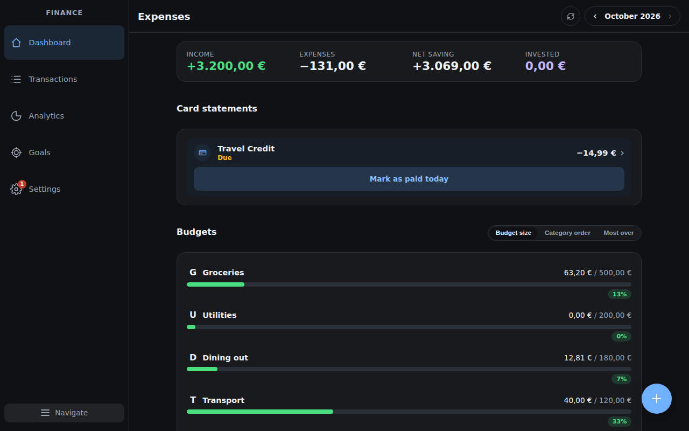 | 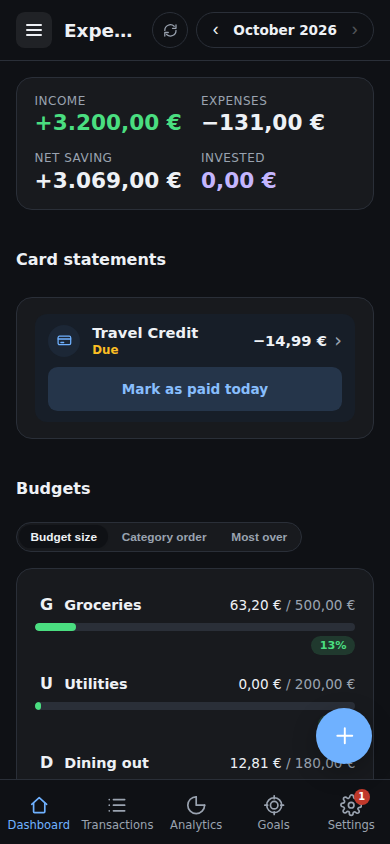 |

| Transactions (desktop) | Transactions (mobile) |
| --- | --- |
| 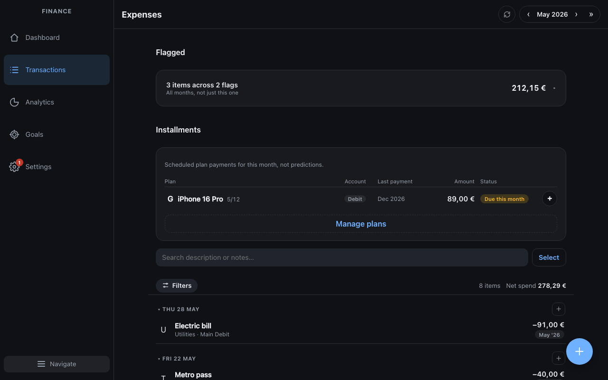 | 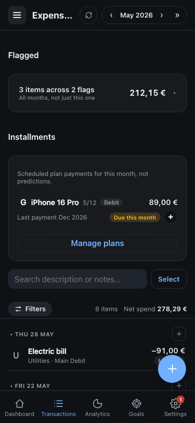 |

| Flags &amp; expense reports (desktop) | Flags &amp; expense reports (mobile) |
| --- | --- |
| 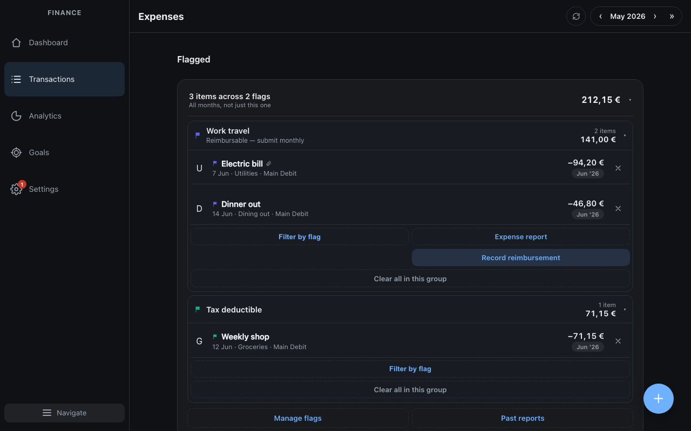 | 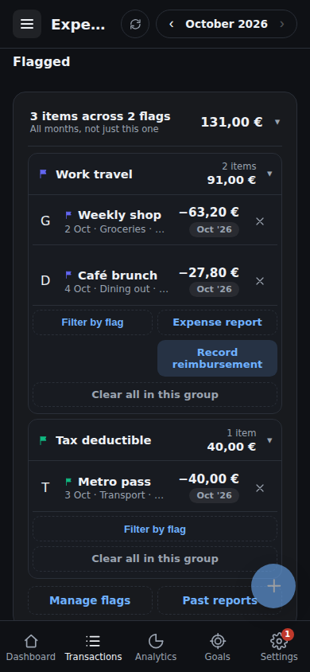 |

| Expense report (desktop) | Expense report (mobile) |
| --- | --- |
| 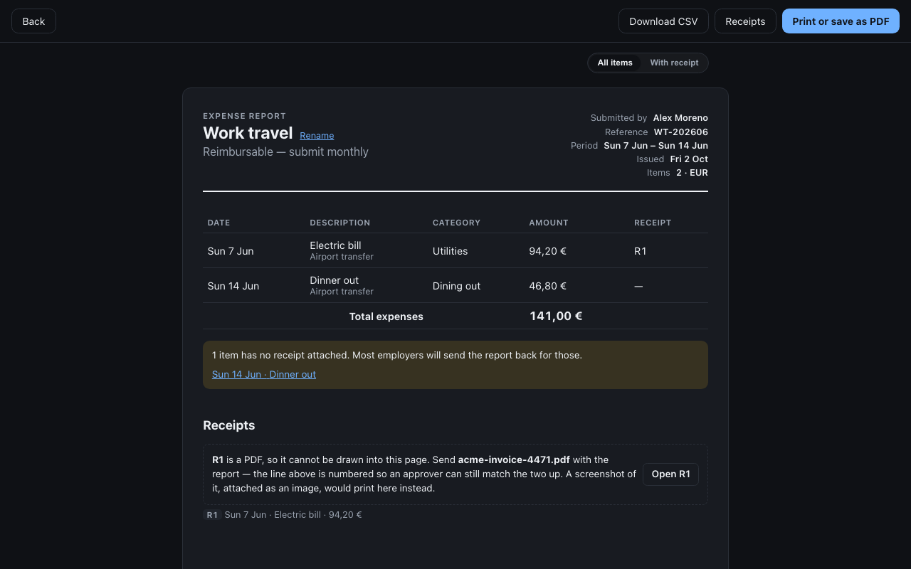 | 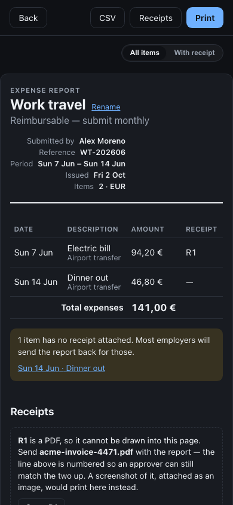 |

| Analytics (desktop) | Analytics (mobile) |
| --- | --- |
| 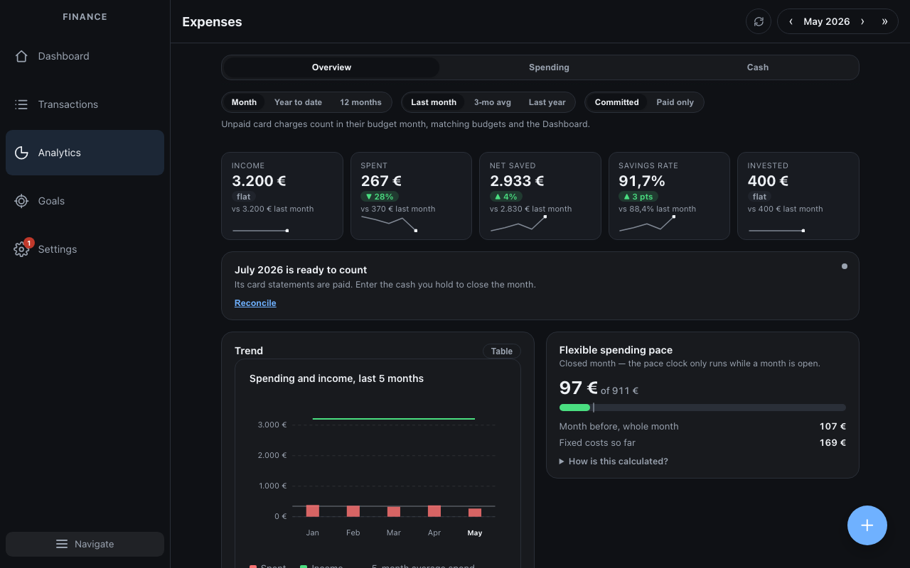 | 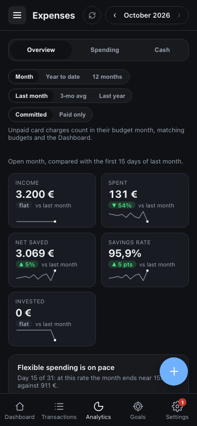 |

| Goals (desktop) | Goals (mobile) |
| --- | --- |
| 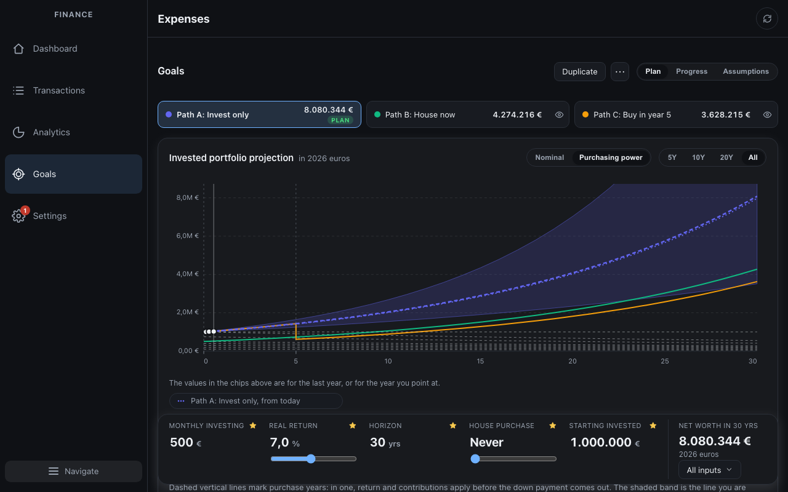 | 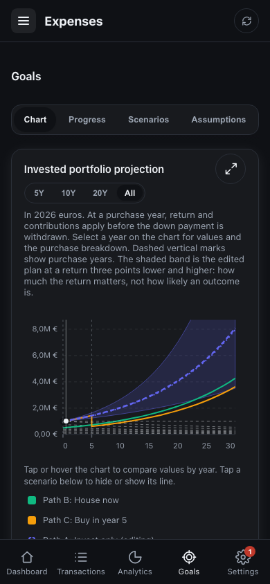 |

| Settings (desktop) | Settings (mobile) |
| --- | --- |
| 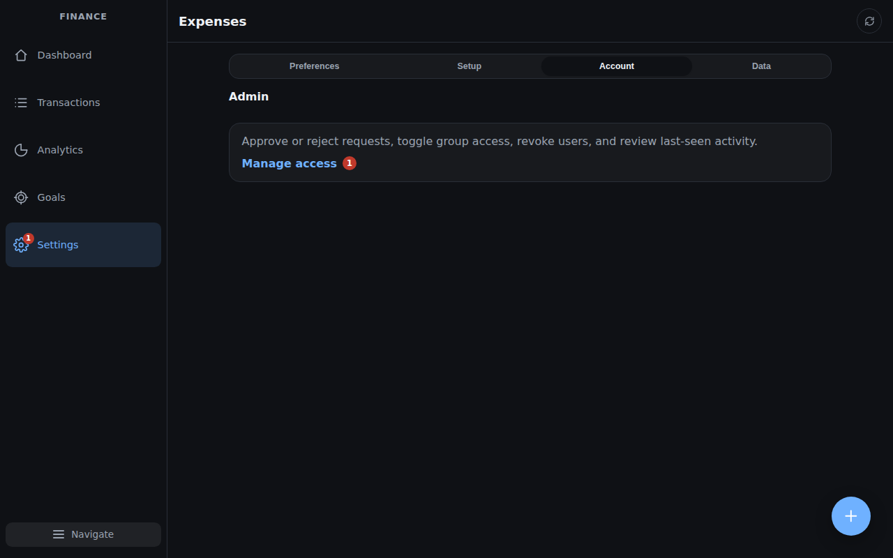 | 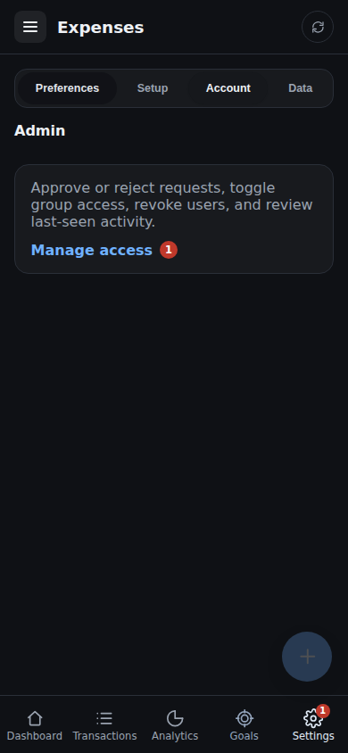 |

Regenerate: `npm run capture:screenshots` (Playwright + Chromium). Writes to `docs/screenshots/gallery/`.

## Local dev

Needs Node 22.13 or later (`.nvmrc` pins 22.23.2, and CI runs Node 22).

```bash
git clone https://github.com/RoyCrivolotti/expense-tracker.git
cd expense-tracker
npm ci
npm run dev
```

Opens at `http://localhost:5173` with **read-only CSV data** imported straight from `fixtures/demo-expenses.csv`. There is no path to real data in local dev. Production uses the D1-backed API.

`/access/admin` works against a deployed API, or with `DOCS_CAPTURE=1` mocks (`npm run capture:screenshots`).

Copy [`.env.example`](./.env.example) → `.env` for hub cross-links (`VITE_*_URL`).

## Self-hosting

This section describes how the deployment is put together. The [license](#license) still applies: running your own copy needs written permission. Example configs are in the repo; your values go in gitignored copies:

| Example | Copy to | Purpose |
| --- | --- | --- |
| [`config/access.example.json`](config/access.example.json) | `config/access.json` | Owner email → `OWNER_EMAIL` Pages env |
| [`config/allowed-emails.example.json`](config/allowed-emails.example.json) | `config/allowed-emails.json` | Bootstrap D1 allowlist |
| [`config/backup-alerts.example.json`](config/backup-alerts.example.json) | `config/backup-alerts.json` | Optional backup alert recipients |
| [`config/goal-scenarios.seed.example.json`](config/goal-scenarios.seed.example.json) | `config/goal-scenarios.seed.json` | Demo or private goal scenarios → `npm run seed:scenarios` |

```bash
npm run verify
cp config/access.example.json config/access.json   # edit ownerEmail
npm run sync:access-env
npm run bootstrap:allowed-users   # when seeding allowlist
npm run deploy
```

Full DNS, Access, D1, and CI setup: [docs/DEPLOYMENT.md](docs/DEPLOYMENT.md).

## Docs

[docs/README.md](docs/README.md) lists every doc and who it is for.

## License

Source-available, not open source. The code is public so that it can be read; all rights are reserved, and any use beyond reading it needs written permission. See [LICENSE](./LICENSE).
